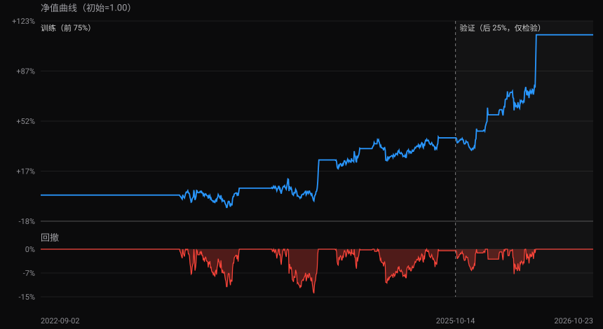

[← 返回文档中心](/docs/) · [stock-analyzer 文档](/docs/stock-analyzer/) · [全部回测报告](/docs/stock-analyzer-backtest/) · 同步于 2026-11-06

`sz000725` 京东方Ａ · 策略 **筹码峰支撑·激进**（`chip_peak` · 激进） · stock-analyzer v7.0.1 · 导出时间 2026-10-25 15:45:41

> 回测区间 2022-09-02 ~ 2026-10-23；成交口径：T 日收盘信号 → T+1 收盘成交，ATR 止损 + 移动止盈，无手续费。
> 训练/验证按时间前 75% / 后 25% 切分，**验证集不参与选型、仅供指标检验**。
> 参数：`atr_mult=2.5`, `trail_trigger=1.05`, `trail_ratio=0.9`, `buy_th=1`, `cooldown=3`, `sell_cooldown=3`。

## 指标

| 指标 | 全期 | 训练集（前75%） | 验证集（后25%） |
|---|---|---|---|
| 交易次数 | 21（已平仓 21） | 11（已平仓 11） | 10（已平仓 10） |
| 胜率 | 57.1%（12/21） | 45.5%（5/11） | 70.0%（7/10） |
| 区间收益 | +112.8% | +40.3% | +51.7% |
| 年化收益 | +20.0% | +11.5% | +50.2% |
| 最大回撤 | -13.8% | -13.8% | -7.8% |
| 盈亏比 | 2.69 | 3.53 | 1.95 |
| 均盈 / 均亏 | +9.9% / -3.7% | +11.7% / -3.3% | +8.7% / -4.5% |
| 未平仓浮盈 | — | — | — |

## 信号质量

| 指标 | 数值 |
|---|---|
| IC(T+1) | 0.093（n=451） |
| IC(T+5) | 0.232（n=447） |

| 信号 | T+1 | T+5 |
|---|---|---|
| 买入信号后 | +0.20% · 上涨 48%（n=265） | +0.73% · 上涨 58%（n=265） |
| 卖出信号后 | -0.05% · 上涨 44%（n=186） | -0.46% · 上涨 37%（n=182） |

> 本页由 `scripts/sync_docs.py` 自动生成：读取 `research/gui_backtests/` 中该股最新一次
> GUI「导出回测」JSON（数据源与本机 stock-analyzer 一致）。
> 所有输出仅为历史数据的技术统计与研究用途，不构成任何投资建议。
